# ambientCG: Bricks materials

**30 assets from [ambientCG](https://ambientcg.com), dedicated to the public domain under [CC0](https://docs.ambientcg.com/license/).** Use them in any game, free or paid, and change them however you like; no credit is needed.

PBR materials as 1K and 2K JPG maps (colour, normal GL and DX, roughness, AO, displacement), one folder per resolution. 887.0 MB in all.

This is a copy kept by [zuujis-cc0](https://github.com/zuujis-cc0) so game makers can take single files from GitHub. It is not made by or affiliated with ambientCG: the originals, often in more formats and higher resolutions, are on [ambientcg.com](https://ambientcg.com). If they help you, consider [supporting ambientCG](https://www.patreon.com/ambientCG).

Every file is listed in [MANIFEST.tsv](MANIFEST.tsv) with its size and SHA-256. More free assets: [the Zuujis collection](https://github.com/zuujis-cc0/free-game-assets#readme).

| | | | |
| :-: | :-: | :-: | :-: |
| <a href="Bricks091">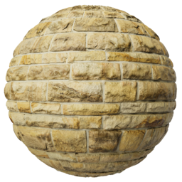</a> <b><a href="Bricks091">Bricks 091</a></b> by ambientCG · <a href="https://ambientcg.com/a/Bricks091">source</a> | <a href="Bricks092">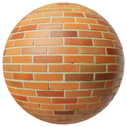</a> <b><a href="Bricks092">Bricks 092</a></b> by ambientCG · <a href="https://ambientcg.com/a/Bricks092">source</a> | <a href="Bricks093">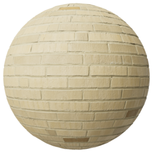</a> <b><a href="Bricks093">Bricks 093</a></b> by ambientCG · <a href="https://ambientcg.com/a/Bricks093">source</a> | <a href="Bricks094">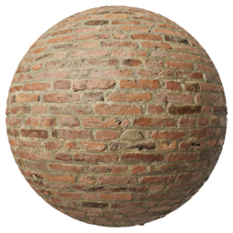</a> <b><a href="Bricks094">Bricks 094</a></b> by ambientCG · <a href="https://ambientcg.com/a/Bricks094">source</a> |
| <a href="Bricks095">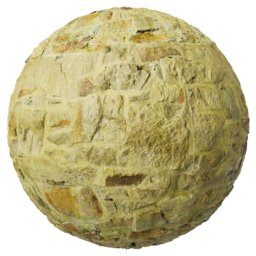</a> <b><a href="Bricks095">Bricks 095</a></b> by ambientCG · <a href="https://ambientcg.com/a/Bricks095">source</a> | <a href="Bricks096">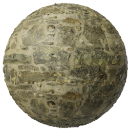</a> <b><a href="Bricks096">Bricks 096</a></b> by ambientCG · <a href="https://ambientcg.com/a/Bricks096">source</a> | <a href="Bricks097">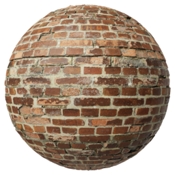</a> <b><a href="Bricks097">Bricks 097</a></b> by ambientCG · <a href="https://ambientcg.com/a/Bricks097">source</a> | <a href="Bricks098">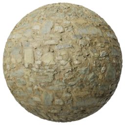</a> <b><a href="Bricks098">Bricks 098</a></b> by ambientCG · <a href="https://ambientcg.com/a/Bricks098">source</a> |
| <a href="Bricks099">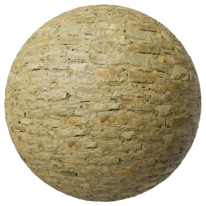</a> <b><a href="Bricks099">Bricks 099</a></b> by ambientCG · <a href="https://ambientcg.com/a/Bricks099">source</a> | <a href="Bricks100">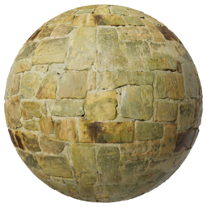</a> <b><a href="Bricks100">Bricks 100</a></b> by ambientCG · <a href="https://ambientcg.com/a/Bricks100">source</a> | <a href="Bricks101">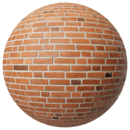</a> <b><a href="Bricks101">Bricks 101</a></b> by ambientCG · <a href="https://ambientcg.com/a/Bricks101">source</a> | <a href="Bricks102">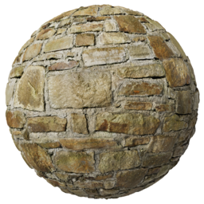</a> <b><a href="Bricks102">Bricks 102</a></b> by ambientCG · <a href="https://ambientcg.com/a/Bricks102">source</a> |
| <a href="Bricks103">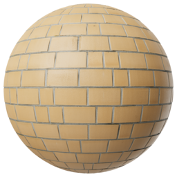</a> <b><a href="Bricks103">Bricks 103</a></b> by ambientCG · <a href="https://ambientcg.com/a/Bricks103">source</a> | <a href="Bricks104">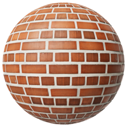</a> <b><a href="Bricks104">Bricks 104</a></b> by ambientCG · <a href="https://ambientcg.com/a/Bricks104">source</a> | <a href="Bricks105">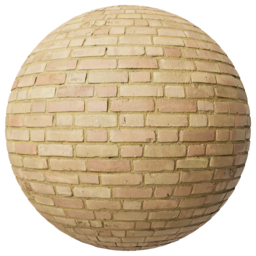</a> <b><a href="Bricks105">Bricks 105</a></b> by ambientCG · <a href="https://ambientcg.com/a/Bricks105">source</a> | <a href="Bricks106A">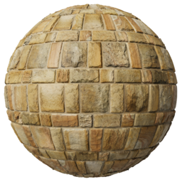</a> <b><a href="Bricks106A">Bricks 106 A</a></b> by ambientCG · <a href="https://ambientcg.com/a/Bricks106A">source</a> |
| <a href="Bricks106B">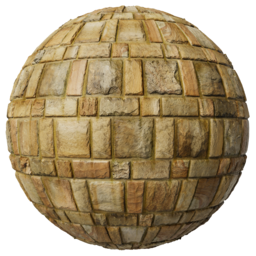</a> <b><a href="Bricks106B">Bricks 106 B</a></b> by ambientCG · <a href="https://ambientcg.com/a/Bricks106B">source</a> | <a href="Bricks107A">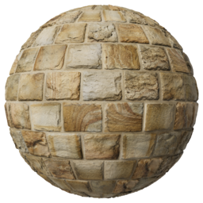</a> <b><a href="Bricks107A">Bricks 107 A</a></b> by ambientCG · <a href="https://ambientcg.com/a/Bricks107A">source</a> | <a href="Bricks107B">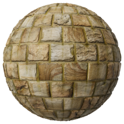</a> <b><a href="Bricks107B">Bricks 107 B</a></b> by ambientCG · <a href="https://ambientcg.com/a/Bricks107B">source</a> | <a href="Bricks108A">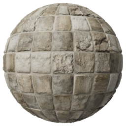</a> <b><a href="Bricks108A">Bricks 108 A</a></b> by ambientCG · <a href="https://ambientcg.com/a/Bricks108A">source</a> |
| <a href="Bricks108B">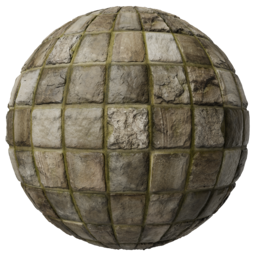</a> <b><a href="Bricks108B">Bricks 108 B</a></b> by ambientCG · <a href="https://ambientcg.com/a/Bricks108B">source</a> | <a href="Bricks109A">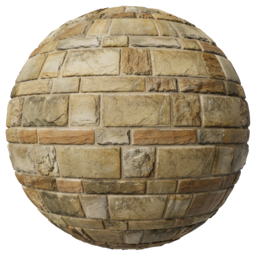</a> <b><a href="Bricks109A">Bricks 109 A</a></b> by ambientCG · <a href="https://ambientcg.com/a/Bricks109A">source</a> | <a href="Bricks109B">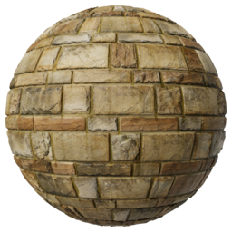</a> <b><a href="Bricks109B">Bricks 109 B</a></b> by ambientCG · <a href="https://ambientcg.com/a/Bricks109B">source</a> | <a href="Bricks110A">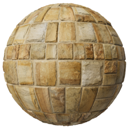</a> <b><a href="Bricks110A">Bricks 110 A</a></b> by ambientCG · <a href="https://ambientcg.com/a/Bricks110A">source</a> |
| <a href="Bricks110B">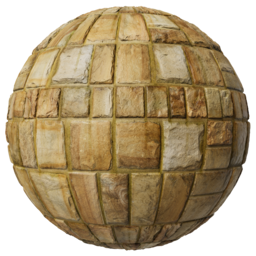</a> <b><a href="Bricks110B">Bricks 110 B</a></b> by ambientCG · <a href="https://ambientcg.com/a/Bricks110B">source</a> | <a href="Bricks111A">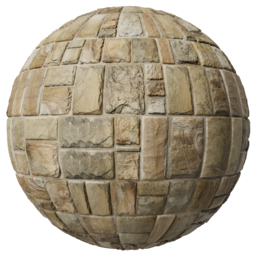</a> <b><a href="Bricks111A">Bricks 111 A</a></b> by ambientCG · <a href="https://ambientcg.com/a/Bricks111A">source</a> | <a href="Bricks111B">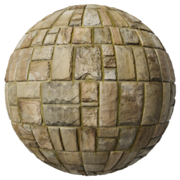</a> <b><a href="Bricks111B">Bricks 111 B</a></b> by ambientCG · <a href="https://ambientcg.com/a/Bricks111B">source</a> | <a href="Bricks112A">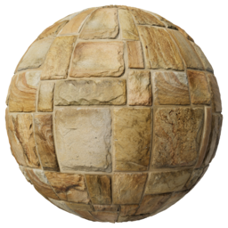</a> <b><a href="Bricks112A">Bricks 112 A</a></b> by ambientCG · <a href="https://ambientcg.com/a/Bricks112A">source</a> |
| <a href="Bricks112B">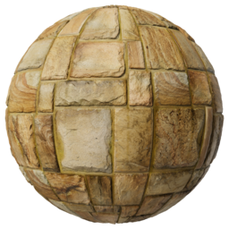</a> <b><a href="Bricks112B">Bricks 112 B</a></b> by ambientCG · <a href="https://ambientcg.com/a/Bricks112B">source</a> | <a href="Bricks113A">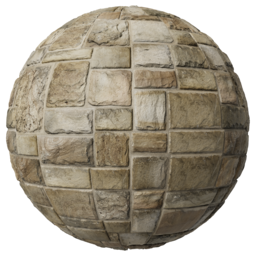</a> <b><a href="Bricks113A">Bricks 113 A</a></b> by ambientCG · <a href="https://ambientcg.com/a/Bricks113A">source</a> |  |  |

---

Kept up to date by this repository's own [update workflow](.github/workflows/update.yml), with code and plan from [cc0-mirror](https://github.com/zuujis-cc0/cc0-mirror). Something wrong? [Open an issue there](https://github.com/zuujis-cc0/cc0-mirror/issues/new) or use the [private report form](https://games.zuujis.com/report).
